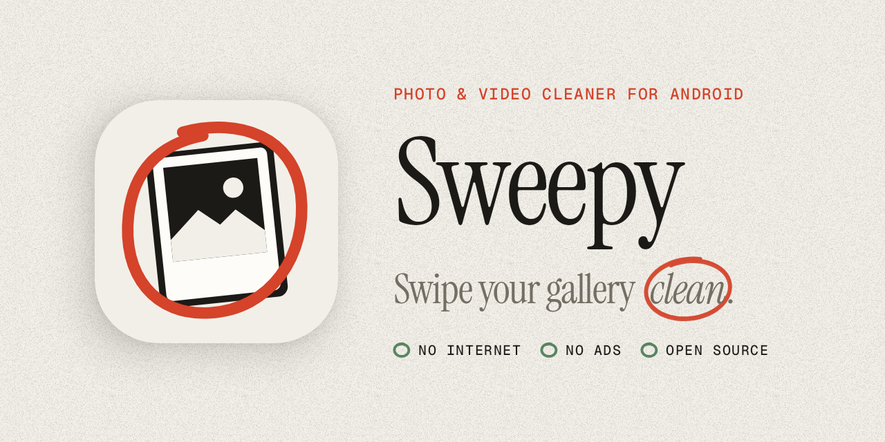
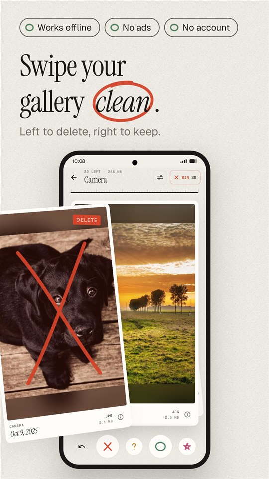
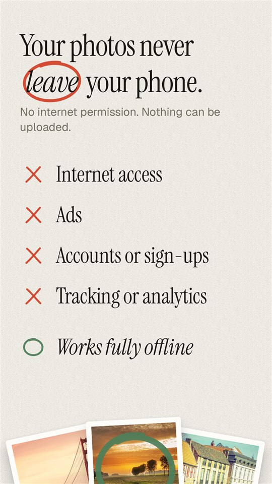
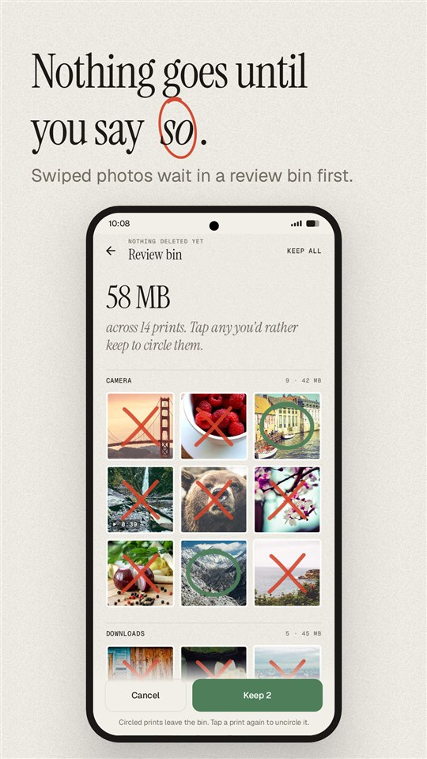
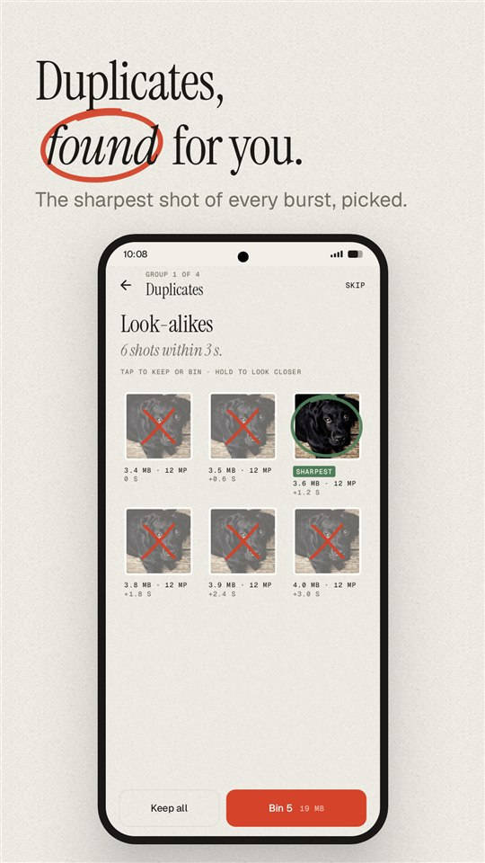
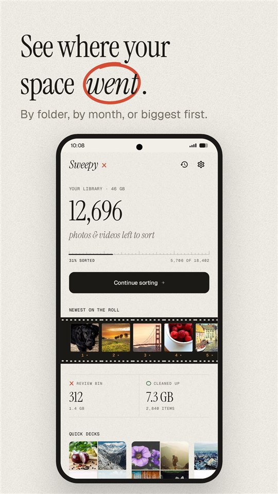
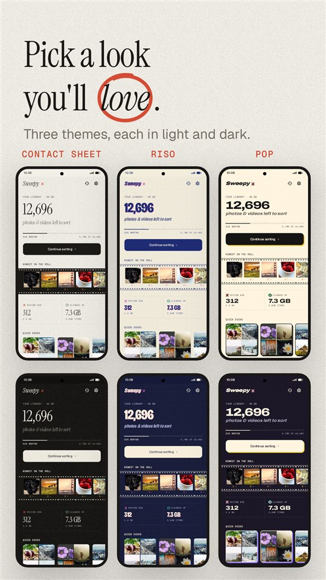

<p align="center">
  <picture>
    <source media="(prefers-color-scheme: dark)" srcset=".github/readme/banner_dark.png">
    
  </picture>
</p>

<p align="center">
  <a href="LICENSE"></a>
  
  
  
</p>

Your gallery has thousands of photos you'll never look at again: blurry pocket shots, screenshots
you needed once, ten copies of the same sunset, "good morning" forwards. **Sweepy turns clearing
them out into a few minutes of swiping.** Left to delete, right to keep.

It does this without ever seeing the internet. Sweepy has no internet permission at all, so your
photos physically cannot leave your phone. No ads, no account, no tracking, no subscription.

<p align="center">
  
  
  
</p>
<p align="center">
  
  
  
</p>

## What it does

**Swipe through your photos and videos**
- Left to delete, right to keep, up for "ask me later", star the ones you love. Every swipe can be undone.
- Videos play right on the card, muted and looping. Pinch any photo to look closer.
- Sort everything at once, or one deck at a time: a folder, a month, screenshots, WhatsApp, or your biggest videos first.
- Filter to only photos or only videos; sort newest, oldest or largest.

**Nothing goes until you say so**
- Everything you swipe left waits in a review bin. Look it over, tap anything you'd rather keep, then clean up.
- Cleaned files go to Android's own trash for about 30 days, and Sweepy can restore them from *Recently cleaned*.

**Duplicates and look-alikes**
- Finds exact copies and bursts of near-identical shots, and suggests the one to keep: the sharpest, the most detailed, or the original. You make the call.

**See where your space went**
- How much is left to sort, how much you've cleaned up, and which folders and months take the most room.

**Make it yours**
- Three looks, each in light and dark: *Contact sheet* (a photographer's darkroom), *Riso* (two-colour print) and *Pop* (bright and chunky).
- Left-handed mode flips the swipes. Haptics, video autoplay and an optional one-time "skip the trash confirmation".
- Optional reminders, worked out on the phone: a nudge when screenshots pile up, the review bin is waiting or space runs low. Never at night, at most once a week.

## Private by design

Sweepy's privacy isn't a policy you have to trust. It's a permission the app doesn't have.

- **No `INTERNET` permission.** Without it, Android won't let an app open a network connection.
  The Play build uses Google Play Billing for the optional tip jar; that library asks for internet
  access, and Sweepy [removes it again](app/src/play/AndroidManifest.xml). Purchases go through the
  Play Store app on the phone instead.
- **No analytics, no crash reporting, no ads, no accounts.** Not even a "privacy-friendly" one.
- **Your decisions stay on the phone** in a small local database, and "Start over" in Settings wipes it.

Check it yourself on any build:

```sh
aapt2 dump permissions Sweepy.apk
```

You'll see photo and video access, media management, notifications and billing. You won't see internet.

## Get Sweepy

Sweepy is in testing on Google Play and will be public soon. Requires Android 11 or newer.

Sweepy is free, with everything included. The Play version has an optional tip jar (coffee, lunch
or dinner) for anyone who wants to say thanks; tips unlock nothing.

## Build it yourself

You'll need JDK 17 or newer and the Android SDK (Android Studio sets both up).

```sh
git clone https://github.com/DarkXAce01/sweepy.git
cd sweepy
./gradlew assemblePlayDebug          # the Google Play build
./gradlew -Pfoss assembleFossDebug   # the build without Google Play Billing (no tip jar)
```

The APK lands in `app/build/outputs/apk/`. Tests, including screenshot tests of every screen:

```sh
./gradlew testPlayDebugUnitTest
```

**Under the hood:** Kotlin, Jetpack Compose with Material 3, Room for the decision ledger,
Media3 for video, Coil for thumbnails, and Android's MediaStore for everything on the phone.
Screens are checked with Robolectric and Roborazzi screenshot tests.

## License

Sweepy is free software under the [GNU GPL v3](LICENSE): you can use, study, change and share it,
and changed versions must stay open source under the same license.

Fonts are under the SIL Open Font License 1.1 (see [`third_party/`](third_party)): Instrument Serif,
Geist, Geist Mono, Bricolage Grotesque and Archivo. Sample photos in the screenshots are from
[Unsplash](https://unsplash.com).
